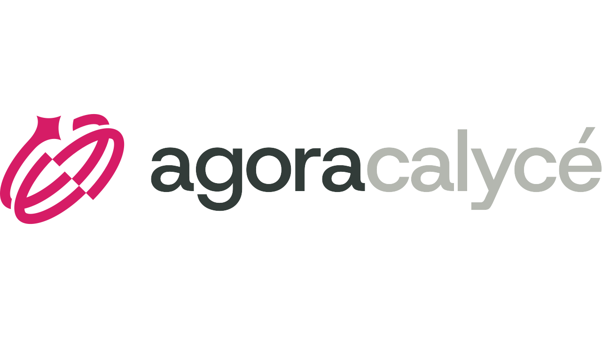

### Un cloud ouvert pour décider librement

**Libre. Responsable. Ouvert.**

---

## 👋 Bienvenue

**Agora Calycé** est un fournisseur de cloud **ouvert, souverain et réversible**, opéré en France.
Notre conviction : *votre infrastructure doit vous donner plus de choix, pas moins.*
Vos données, vos infrastructures et vos choix technologiques restent sous votre contrôle.

> *La souveraineté ne se revendique pas. Elle se démontre.*

## ☁️ Nos offres

| | Offre | En bref |
|---|---|---|
| 🏢 | **Datacenters souverains** | Housing, fibre noire, financement matériel |
| 🌐 | **Cloud public** | *Open source as a Service* : IaaS, PaaS, Kubernetes managé, bases de données managées |
| 🔒 | **Infrastructure et cloud privés** | Environnements dédiés et maîtrisés |
| 🤖 | **IA souveraine** | LLM privés, GPU souverains |
| 🛡️ | **Sécurité** | PRA/PCA, ISO 27001, HDS v2 |
| 🧭 | **Services professionnels** | Migration cloud, DevSecOps, conseil |

👉 [Découvrir toutes nos offres](https://www.agoracalyce.com/offres/)

## 🧱 Nos six piliers

- **Ouverture concrète** : standards ouverts et open source, sans enfermement propriétaire
- **Souveraineté opérationnelle** : infrastructures exploitées en France, sous droit français
- **Liberté structurelle** : réversibilité garantie, vous restez libre de partir
- **Performance durable** : efficacité technique et sobriété
- **Agilité responsable** : innover sans compromettre la maîtrise
- **IA souveraine** : l'intelligence artificielle sans céder vos données

📜 [Lire notre manifeste](https://www.agoracalyce.com/a-propos/le-manifeste/)

## ✅ Certifications

## 🤝 Ils nous font confiance

Collectivités territoriales · Économie sociale et solidaire · Industrie et énergie · Santé · Éditeurs de logiciels · Opérateurs et PME-ETI · Finance et services réglementés

## 📍 Nous trouver

**Strasbourg** (siège) · **Lyon** · **Grenoble** (Meylan) · **Paris**

## 🚀 Nous rejoindre

Envie de construire un cloud libre et souverain ? [Consultez nos offres d'emploi](https://www.agoracalyce.com/recrutement/)

---

[Contact](https://www.agoracalyce.com/contactez-nous/) · [Prendre rendez-vous](https://www.agoracalyce.com/prendre-rendez-vous/) · [Ressources](https://www.agoracalyce.com/toutes-nos-ressources/) · [Newsletter](https://www.agoracalyce.com/newsletter/)

© Agora Calycé · Cloud ouvert, souverain et réversible 🇫🇷

